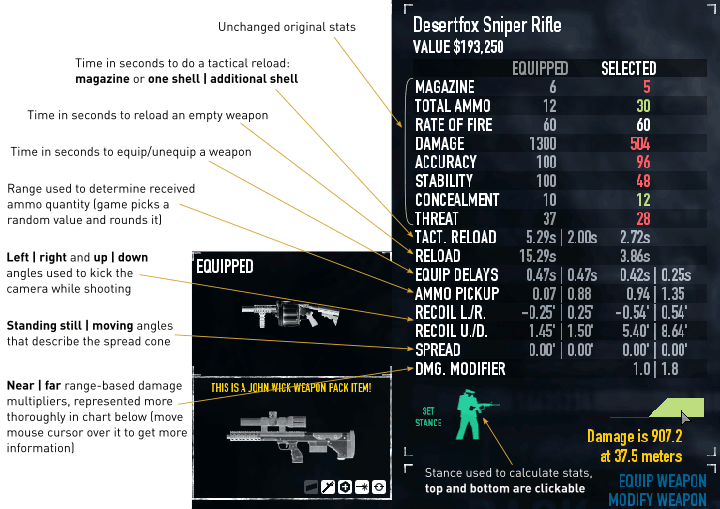
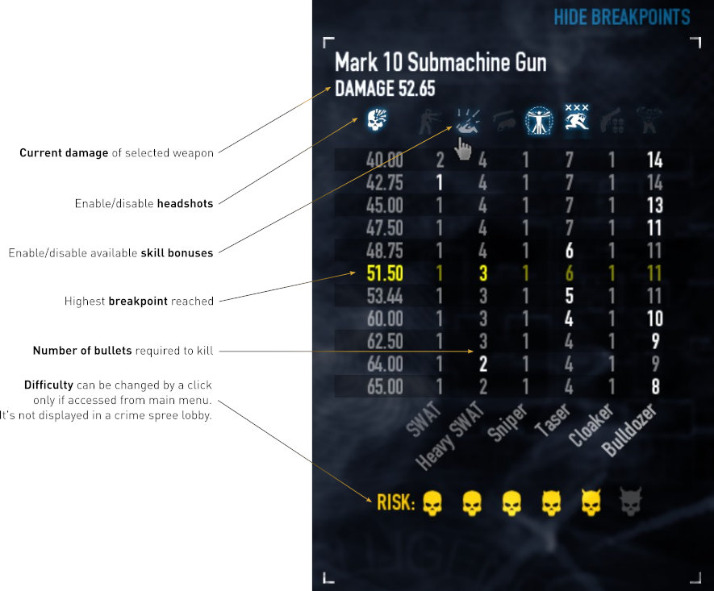
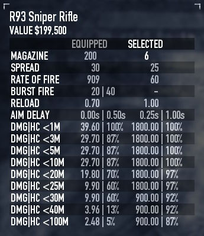

# More Weapon Stats

Extended weapon statistics for the PAYDAY 2 Black Market, rebuilt as a pure-Lua
mod for **PAYDAY 2 248.2** (64-bit, SuperBLT).

The mod keeps the original name, options, localization and player-facing layout.
It adds the numbers the vanilla Black Market does not show, without spawning or
faking any engine weapon unit.

## Original mod description

From the original [More Weapon Stats page](https://pd2mods.z77.fr/more_weapon_stats.html):

> This mod is an extension to the weapon inventory more than inspired by
> [Better Weapon Stats GUI](http://steamcommunity.com/groups/PD2-BWS-GUI)
> (deprecated).

### Player inventory

To get an idea of the efficiency of a weapon accross difficulty levels, the
usual stats panel can be swapped with breakpoints table:





- You can use SPACE key to switch breakpoints display.
- Headshot bonus is represented by bullseye's icon but it's not related to this
  skill anyhow.
- HVT bonus differs if you unlocked basic or ace.
- For criticals, the first bullet is always accounted as such. Total amount of
  crits depends on critical chance.
- Berserker simulates damage done with health level that player gets after being
  revived.

### Crew inventory

Weapons used by NPC teammates have different settings and falloff rules than
players have.



DMG|HC stands for damage and average hit chance.

Also, it's worth mentioning that when a NPC shooter is under suppressive fire
effects:

- his hit chance is halved;
- his aim delay is increased by 50%.

## What it shows

- Extended weapon rows: tactical/full reload, equip/unequip delay, ammo pickup,
  horizontal and vertical recoil, horizontal and vertical spread, damage falloff.
- Breakpoint table: damage needed to kill each enemy type in a chosen number of
  hits, with headshot/crit/Berserker/Overkill/Trigger Happy/Underdog/HVT/body
  expertise toggles.
- Difficulty preview for the breakpoint table, without changing the difficulty
  the game is actually running.
- Melee stats: attack delay, cooldown, unequip delay, special effect and DoT
  length.
- Henchman/NPC weapon stats: damage and hit chance by range, rate of fire,
  reload, aim delay and falloff.
- Damage-range charts and stance preview (hip fire, ADS, standing, crouched).
- DLC information, existing localization files and the original settings menu.

## 248.2 rewrite and crash fix

The original implementation built fake weapon units and swapped gameplay weapon
classes into menu code. On 248.2 that could crash natively in
`_set_material_textures` while a real menu weapon was assembled, especially when
entering the Black Market or previewing/applying a skin.

This rewrite removes that engine entirely:

- no `Faker`, `Overrider`, fake units, fake `PlayerInventory` or `SoundDevice`;
- no `NewRaycastWeaponBase` / `ShotgunBase` / other weapon-class hooks;
- no fake `PlayerInventory` registration, manager stubs or class snapshots;
- no `xpcall` assumptions (PAYDAY 2 Lua has no `xpcall`);
- auto-updates come from this repository's GitHub releases, not the old v76
  update endpoint.

Stats are computed by a pure-Lua `WeaponModel` from:

- `tweak_data.weapon` and `tweak_data.weapon.stats`;
- the crafted blueprint and `tweak_data.weapon.factory.parts`
  (`adds`, `forbids`, `override`, part stats and custom stats);
- the player skill/perk/difficulty context;
- crafted cosmetics, including skin bonus stats.

The Black Market UI reads that model instead of a fake weapon base.

Fixes found during the rewrite testing:

- module loading uses an explicit chunk loader
  (`blt.vm.loadfile` → `loadfile` → `io.open`/`loadstring`). SuperBLT's
  `dofile` does not return a chunk's value; the old bootstrap treated that as a
  fatal module error;
- the breakpoint table/bonus icons/difficulty picker build correctly on engine
  userdata panels, and the open/closed flag is kept separate from the breakpoint
  row list.

## Requirements

- PAYDAY 2 248.2, 64-bit.
- [SuperBLT](https://superblt.znix.xyz/) installed and working.

## Installation

1. Close PAYDAY 2.
2. Remove or rename any older More Weapon Stats folders in
   `...\PAYDAY 2\mods\`:
   - `More Weapon Stats`
   - `More Weapon Stats-fix-crash`
   - `More Weapon Stats-mws-rewrite`
3. Download `MoreWeaponStats_v1.zip` from
   [Releases](https://github.com/met94/payday2-more-weapon-stats/releases/latest)
   and extract it so the result is exactly:
   `...\PAYDAY 2\mods\More Weapon Stats\mod.txt`
4. Launch the game and open the Black Market.

If you download the GitHub source ZIP instead, rename the extracted
`payday2-more-weapon-stats-main` folder to `More Weapon Stats`.

SuperBLT's update check (Simple Mod Updater) reads
`releases/latest/download/meta.json` from this repository, so later releases
can be installed through the normal mod updater.

Settings are stored in `...\PAYDAY 2\mods\saves\more_weapon_stats.txt`.
Old v76 setting keys are preserved.

Logs are in `...\PAYDAY 2\mods\logs\`. The expected line is
`Setting up mod 'More Weapon Stats'`; there should be no
`[More Weapon Stats] failed to load` or `FATAL ERROR` line.

> Do not install two folders with the same `mod.txt` name. SuperBLT treats the
> name as the dependency key and one copy will win unpredictably.

## Compatibility

Verified against the current load order with:

- Super Duper Skin Swapper
- Optional Skin Attachments
- Hide Duplicate Skins
- VanillaHUD Plus
- The Fixes
- Anticrash
- Mod Hider
- Extra Heist Info

The rewrite installs no weapon-class hooks and writes no globals outside its own
`MoreWeaponStats` table. Skin data is read from the crafted weapon and passed to
the model; the mod does not replace the skin-preview callbacks.

## A note on rifle falloff

In 248.2 many rifles (for example Lion's Roar/`vhs`, CAR-4/`new_m4`, AMCAR)
carry no `damage_falloff` or `damage_near`/`damage_far` data. For those weapons
the `Dmg. modifier` row and the range chart are blank by design. Shotguns,
pistols, SMGs, LMGs and snipers do have that data and display it.

## Development

Repository layout:

```text
lua/
  entry.lua              settings, loader, module bootstrap
  blackmarketgui.lua     Black Market hooks and adapters
  core/                  context, weapon model, ballistics, timers, accuracy,
                         ammo, breakpoints
  ui/                    stats, breakpoint, melee and henchman panels
  compat.lua             compatibility notes/contracts
  menumanager.lua        localization and settings menu
menu/options.txt         settings menu definition
loc/                     translations
tests/                   headless LuaJIT specs (not shipped in the mod zip)
MENU_OPTIONS.md          player-facing option guide
changelog.txt            release notes / player notes
```

Run the headless suite from the repository root with LuaJIT:

```powershell
luajit tests\run_tests.lua
```

Optional syntax gate:

```powershell
luajit -bl lua\entry.lua
```

The current release is **v1** (the clean rewrite resets the old 76-80 version
line). Keep `mod.txt`, `changelog.txt` and the GitHub release tag in sync when
shipping changes.

## Credits

Original More Weapon Stats by TdlQ, with code from Better Weapon Stats GUI by
KarateF22, code maintenance by Nexqua, and translations by Arknights (Chinese),
NewPJzuza (Thai), andole and x(GOREMAGEDDON)x (Russian), Kilowide (Spanish).

This repository is the 248.2 clean-Lua rewrite.

## License

No license was published on the original More Weapon Stats page or in the
original v76 archive. The clean rewrite code in this repository is released under
the **Unlicense** (public-domain dedication); see [LICENSE](LICENSE).

The original mod name, localization files, screenshots, icons and any retained
original content remain credited to their original authors. No ownership is
claimed over those parts. If you are an original author and want different terms,
open an issue.
